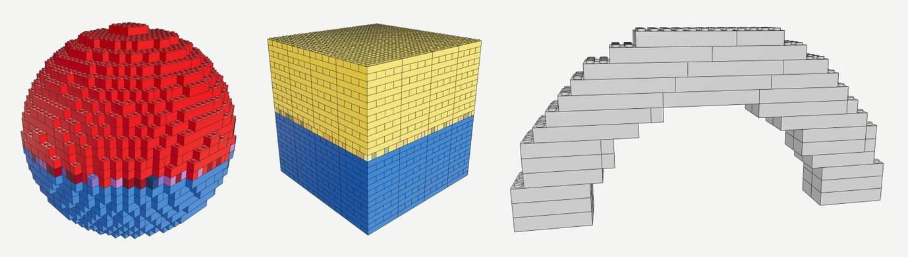

# brickbuild

Turn a 3D model, and eventually a few photos of a real object, into a toy
brick model you can actually build: a parts layout that holds together, a step
by step instruction manual and a parts list you can order. Everything is made
of standard LDraw compatible parts.



*The three phase 1 test shapes after conversion: a 32 stud sphere with
vertex colours (1753 parts), a cube with a texture (1852 parts) and an
uncoloured arch (64 parts). Rendered from the generated `.ldr` files.*

> **Status: early development.** Phases 0 and 1 of 8 are done. A mesh goes in
> and a valid LDraw model made of standard bricks comes out. Stability
> analysis, instructions, parts list exports and photo input are not built
> yet. See [Status and roadmap](#status-and-roadmap).

## The idea

Making something *look* like it is built from bricks is easy. Making
something you can really build is not: the parts have to exist, connect to
each other, stand up under their own weight, come in colours you can buy, and
go together in an order a person can follow.

brickbuild is a pipeline, not one AI model. Getting a 3D mesh from photos is
treated as the easy, replaceable part (an image to 3D model behind a simple
interface). The work of this project is everything after that:

- choosing real parts that interlock, with overlapping seams instead of
  stacked columns,
- checking that every brick is connected to the ground and the model can
  carry its own weight, and repairing it when it cannot,
- ordering the build into small, reachable steps and rendering a manual,
- producing a parts list with real part and colour combinations, ready to
  order.

## How it works

```
photos -> [1 mesh] -> [2 voxels] -> [3 brick layout] -> [4 stability] -> [5 instructions + parts list]
                                          ^                    |
                                          +---- re-tile -------+
```

| Stage | What it does | Output | State |
|---|---|---|---|
| 1. Mesh | Load a `.glb`, `.gltf`, `.obj` or `.stl` file and turn it upright. Later: generate the mesh from photos. | `<name>.mesh.glb` | File loader done |
| 2. Voxels | Scale the model to a size in studs and fill it with brick sized cells (8 x 8 x 9.6 mm). Sample each cell's colour from the mesh and snap it to a real brick colour. | `<name>.voxels.npz` | Done |
| 3. Layout | Merge cells of the same colour into real bricks. | `<name>.layout.json` | Greedy baseline done, optimisation planned |
| 4. Stability | Connection graph, floating brick detection, physics check, local repair. | | Planned (phase 2) |
| 5. Instructions | Build steps, submodels, PDF manual, parts lists. | | Planned (phase 3) |
| Export | Write the model in the LDraw format. | `<name>.ldr` | Done |

Every stage reads and writes a plain file, so each one can be run, inspected
and debugged on its own.

## Status and roadmap

| Phase | Scope | State |
|---|---|---|
| 0 | Project scaffold: uv, CLI, tests, lint, CI | Done |
| 1 | Mesh to bricks to LDraw, the thin end to end slice | Done |
| 2 | Layout quality and sturdiness: connection graph, no floating bricks, seam optimisation, physics check, repair loop, hollowing | Next |
| 3 | Instructions and parts list: step ordering, submodels, PDF manual via LPub3D, CSV and BrickLink wanted list, availability checks | Planned |
| 4 | Photo input: a mesh provider interface, an AI image to 3D model (TRELLIS.2 first), background removal | Planned |
| 5 | Surface refinement: plates, slopes and tiles on the outside | Planned |
| 6 | Functional modules, starting with wheels and axles | Planned |
| 7 | Web UI: upload, 3D preview, size controls, manual download | Planned |

### What works today

- Loading meshes from `.glb`, `.gltf`, `.obj` and `.stl`, with `--up z` for Z up exports.
- Scaling to a target size (`--size 32` studs on the longest side by default).
- Solid filling at brick resolution, robust to rays passing through mesh
  edges and to overlapping parts of a mesh.
- Colour from textures, vertex colours or face colours, snapped to the
  nearest LDraw colour in CIELAB space. The palette is read from the LDraw
  library, not hardcoded.
- A greedy layout using the 11 standard bricks from 1x1 to 2x8.
- LDraw `.ldr` output, one build step per layer, that loads in LDraw viewers.
- A summary after every build: total parts, distinct parts, distinct part and
  colour combinations, colours used and model size in centimetres.

### Known limitations

- **Stability is not checked yet.** A model can contain floating bricks or
  overhangs that would fall off. Every build prints
  `stability: NOT CHECKED` until phase 2 lands. Even then, "stable" will mean
  "passes our analysis", not a guarantee about a physical build.
- Only standard bricks: no plates, slopes or tiles yet, so surfaces are
  stepped and models are built in 9.6 mm layers.
- The greedy layout uses many small parts (506 of the sphere's 1753 parts are
  1x1) and does not yet optimise seams across layers.
- Models are solid. The hidden interior is filled and coloured, which costs
  parts and adds colour combinations. Hollowing comes in phase 2.
- Colours snap to all 102 solid LDraw colours, including rare ones that may
  not exist for a given part. Availability checks come in phase 3.
- A sharp colour border on the mesh gives a thin band of in between colours.
- Meshes with holes fall back to a simpler fill rule (the build prints a
  note), which can leave gaps or stray columns.
- No price estimate yet: there is no price data until phase 3.

## Getting started

### Requirements

- [uv](https://docs.astral.sh/uv/) (it installs Python 3.12 for you)
- The official LDraw parts library, downloaded separately (a 146 MB zip, about 550 MB unpacked)

### Install

```
git clone https://github.com/Jarlarex/brickbuild.git
cd brickbuild
uv sync
```

### Add the LDraw parts library

Download https://library.ldraw.org/library/updates/complete.zip and unzip it
into `vendor/`. The zip holds a single `ldraw/` folder, so you end up with
`vendor/ldraw/parts/`, `vendor/ldraw/p/` and `vendor/ldraw/LDConfig.ldr`.
`vendor/` is gitignored.

Then tell brickbuild where it is:

```
cp .env.example .env
```

The CLI loads `.env` from the current folder or any parent folder. A relative
path in it is resolved against the folder holding the `.env` file. A real
`LDRAW_LIBRARY_PATH` environment variable takes precedence.

Check the setup:

```
uv run brickbuild library
```

This prints the library location and the origin and dimensions of part 3001
(Brick 2 x 4), read from its `.dat` file.

### First build

Generate the test shapes and convert one:

```
uv run python -m tests.fixtures out/fixtures
uv run brickbuild build out/fixtures/arch.stl --out out/
```

```
out/fixtures/arch.stl -> out/arch.ldr
grid: 32 x 4 studs, 13 layers, 816 cells filled
parts: 64 total, 4 distinct parts, 4 distinct part and colour combinations
      28 x 3007  Brick 2 x 8
      26 x 2456  Brick 2 x 6
       6 x 3010  Brick 1 x 4
       4 x 3001  Brick 2 x 4
colours: Light Bluish Grey (71) x 64
size: 25.6 x 3.2 cm footprint, 12.5 cm tall (32 x 4 studs)
stability: NOT CHECKED (connectivity and physics checks come in phase 2)
cost: not estimated (no price data until phase 3)
note: mesh has no colour information: used colour 71
```

## Commands

| Command | What it does |
|---|---|
| `brickbuild build MESH` | Run every stage and write all stage files plus `<name>.ldr` |
| `brickbuild mesh MESH` | Stage 1: load a mesh and write it Y up as `<name>.mesh.glb` |
| `brickbuild voxelize MESH` | Stage 2: write `<name>.voxels.npz` |
| `brickbuild layout VOXELS` | Stage 3: write `<name>.layout.json` and print the parts summary |
| `brickbuild ldraw LAYOUT` | Write `<name>.ldr` from a layout file |
| `brickbuild library` | Check the LDraw library and report a part's origin and size |

Common options:

| Option | Default | Meaning |
|---|---|---|
| `--size N` | 32 | Longest side of the model in studs (1 stud = 8 mm) |
| `--up y\|z` | y | Vertical axis of the input mesh |
| `--default-colour CODE` | 71 | LDraw colour for meshes without colour (71 is Light Bluish Grey) |
| `--out DIR`, `-o DIR` | `out` | Output folder |

Run `uv run brickbuild COMMAND --help` for details.

## Viewing the result

The `.ldr` file opens in any LDraw viewer or editor, for example
[LeoCAD](https://www.leocad.org/), [BrickLink Studio](https://www.bricklink.com/v3/studio/download.page)
or [LDView](https://tcobbs.github.io/ldview/). Each layer is one build step,
so stepping through the model shows it growing from the ground up.

## Design notes

**Units.** 1 LDU = 0.4 mm. A stud pitch is 20 LDU (8 mm), a brick is 24 LDU
(9.6 mm) tall and a plate 8 LDU (3.2 mm). Internally a brick's height
position is stored in plate units from the start, so plates can be added in
phase 5 without changing the data format.

**Filling the shape.** A cell is solid when its centre lies inside the mesh.
Inside or outside is decided by casting a vertical ray through every column
of cells. Where a ray passes exactly through an edge shared by two triangles,
a tie rule gives the hit to exactly one of them, so it is never counted twice
or missed. Closed meshes use the winding number, so overlapping pieces of a
mesh merge into one solid. Meshes with holes fall back to the even-odd rule.

**Colour.** For each surface sample the colour comes from the texture
(including the glTF base colour factor), the vertex colours or the face
colours. Samples are snapped to the nearest palette colour by distance in
CIELAB, and each cell takes the most common colour among its 8 nearest
samples. Voting after snapping avoids inventing blended colours.

**Layout.** Each layer is tiled with the largest parts first. Between parts
of equal area the 2 wide one wins, as it is the more common part, and the
preferred direction of long bricks alternates from layer to layer so seams
tend to cross. Phase 2 replaces this with an optimised layout.

**LDraw output.** LDraw uses -Y as up. The model is turned by 180 degrees
about the X axis rather than mirrored, so it keeps its handedness. Each
part's origin was read from its `.dat` file rather than assumed (for the
starter bricks it is the centre of the top face of the brick body), and the
tests check every part's placement against its real geometry from the
library.

**Verification.** The acceptance tests build a sphere, a cube and an arch
from `.obj`, `.glb` and `.stl` files. They check every part line against the
library and colour table, and check that no two parts overlap. The overlap
check places the real part shapes from the library using each line's
position and rotation, independent of the code that wrote the file.

## Development

```
uv run pytest
uv run ruff check . && uv run ruff format .
```

- Tests that need the LDraw library are skipped when it is missing. Set
  `BRICKBUILD_REQUIRE_LIBRARY=1` to make them fail instead. CI does this, and
  downloads and caches the library itself.
- Test meshes are generated in code (`tests/fixtures/shapes.py`). No binary
  meshes are committed.
- `CLAUDE.md` holds the full plan, domain facts and working rules.

```
src/brickbuild/
  cli.py          command line interface, one command per stage
  mesh/           stage 1: mesh providers (file loader)
  voxel.py        stage 2: solid filling and colour sampling
  layout/         stage 3: brick layout (greedy baseline)
  brick.py        the Brick data model, overlap checks, layout files
  ldraw.py        LDraw library access and .ldr reading and writing
  parts.py        part catalogue: ids, footprints, heights, origins
  colours.py      LDConfig.ldr palette and CIELAB colour matching
  bom.py          parts counts (exports come in phase 3)
  env.py          .env loading
tests/            unit, property and acceptance tests
```

## Credits

- Part geometry and colours come from the [LDraw](https://www.ldraw.org/)
  parts library, maintained by the LDraw.org community and licensed under
  CC BY 4.0. It is downloaded separately and not included in this
  repository.
- brickbuild is an independent project and is not affiliated with or
  endorsed by any toy brick manufacturer.
